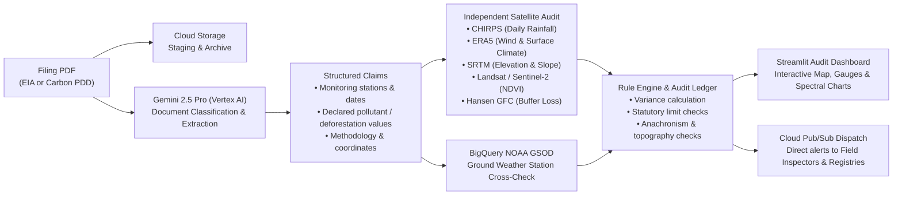

# 🛰️ Accent.AI

**Independent Satellite Verification for Environmental Filings and Carbon Credit Baselines**

Accent.AI checks the truth of environmental filings—such as **Environmental Impact Assessments (EIAs)** and **Voluntary Carbon Credit Project Design Documents (PDDs)**—against independent satellite observations and climate reanalysis.

When an applicant claims a baseline that contradicts historical climate reality or satellite records, Accent.AI flags the discrepancy, calculates the real-world variance, and dispatches a verified alert over Google Cloud Pub/Sub to field inspection teams, rangers, or carbon registries.

---

## The Problem: How Baselines Get Manipulated

Most environmental fraud does not involve falsifying numbers out of thin air. Instead, filings exploit **spatio-temporal bias** to make dangerous projects appear compliant, or uncredited forest land look under threat:

| Gaming Method | What the Filing Does | What Satellites Actually See | Independent Data Source |
|---|---|---|---|
| **Seasonal Dilution (EIA)** | Sampling river effluent during a 98th-percentile monsoon flood so pollutants read artificially low | The river was running at 8× normal flow on the sampling date, diluting the effluent below regulatory limits | **CHIRPS** Precipitation & **ERA5-Land** |
| **Wind & Upwind Bias (EIA)** | Placing an air monitoring sensor 2 km upwind of an industrial stack | Prevailing winds blew the emission plume in the opposite direction from the monitoring station | **ERA5** 10m Wind Vectors |
| **Steep Counterfactuals (Carbon REDD+)** | Picking a steep, inaccessible 34° mountain ridge beside a haul road as the reference "control plot" | The reference plot was inherently non-comparable, artificially inflating baseline deforestation rates to create phantom credits | **SRTM 30m Digital Elevation Model** |
| **Seasonal Greening (Carbon ARR)** | Measuring tree canopy right after seasonal rains and comparing it to a dry-season baseline | The claimed "+22% canopy gain" disappears when compared against season-matched historical satellite records | **Sentinel-2 MSI** & **Landsat 5/7 NDVI** |
| **Perimeter Leakage** | Claiming zero deforestation within project boundaries while logging accelerates just across the fence | Canopy loss spiked +42% in the 1–3 km buffer ring surrounding the concession | **Hansen Global Forest Change (GFC)** |

---

## How It Works



1. **Document Classification & Extraction (Gemini 2.5 Pro on Vertex AI)**:
   Extracts monitoring dates, geographic coordinates, declared baseline parameters, regulatory standards, and methodology statements into validated Pydantic models. Automatically recognizes whether a filing is an industrial EIA, a REDD+ avoided deforestation project, an ARR reforestation project, or an out-of-scope renewable energy facility.

2. **Independent Earth Observation Verification (Google Earth Engine & BigQuery)**:
   Queries satellite constellations and climate models over the declared coordinates and sampling windows:
   - **CHIRPS & ERA5-Land**: Identifies whether effluent sampling occurred during extreme weather or flood events.
   - **SRTM 30m DEM**: Verifies whether control plots match project sites in elevation and slope.
   - **Sentinel-2 & Landsat 5/7**: Compares claimed vegetation baselines against season-matched historical satellite imagery.
   - **Hansen Global Forest Change**: Audits concentric buffer rings to detect activity leakage.
   - **BigQuery NOAA GSOD**: Verifies satellite precipitation readings against physical ground weather gauges.

3. **Audit Ledger & Ground Alerting (Google Cloud Pub/Sub)**:
   Calculates discrepancies against statutory thresholds. If a filing fails compliance checks, a structured alert payload is dispatched to `accent-ground-dispatch` with exact inspection coordinates, parameter discrepancies, and suggested field actions.

---

## Specialized Forensic Capabilities

- **Dynamic Forestry Metrics (REDD+ vs. ARR)**: Distinguishes avoided deforestation rates from afforestation canopy gain. Never compares an avoided deforestation baseline to net vegetative growth.
- **Satellite Sensor Anachronism Protection**: Automatically selects the historically accurate satellite sensor. For filings with baseline dates prior to June 2015 (before Sentinel-2 was launched), the system dynamically uses **Landsat 5/7** and **MODIS Surface Reflectance**, preventing sensor anachronisms.
- **Topography & Elevation Auditing**: If an applicant omits baseline elevation, the system bypasses misleading zero-elevation mathematical variances and instead benchmarks the location using independent SRTM elevation and slope telemetry.
- **Out-of-Scope Methodology Detection**: For non-land-use filings (such as grid-connected wind, solar, or cookstoves that depend on electrical SCADA data rather than surface reflectance), the system provides clear advisory notices rather than forcing optical satellite checks.
- **Statutory Limit Respect**: Validates declared readings against regional environmental laws (such as State Pollution Control Board effluent standards). If measurements comply with statutory thresholds under normal weather conditions, the system issues automated regulatory clearance.

---

## Repository Structure

```text
├── app.py                      # Main Streamlit audit workspace and interactive dashboard
├── schemas.py                  # Pydantic data models for extraction and satellite evidence
├── services/
│   ├── __init__.py             # Google Cloud project and authentication setup
│   ├── gemini_extractor.py     # Vertex AI Gemini extraction and audit review logic
│   ├── earth_engine_verifier.py# Earth Engine and BigQuery satellite verification service
│   ├── pubsub_dispatcher.py    # Cloud Pub/Sub regulatory dispatch publisher
│   └── storage_service.py      # Cloud Storage staging service
├── Dockerfile                  # Production container configuration for Cloud Run (:8080)
├── requirements.txt            # Python dependencies
└── .streamlit/
    └── config.toml             # Streamlit visual theme configuration
```

---

## Local Quickstart

### Prerequisites
- Python 3.9, 3.10, 3.11, or 3.12
- Google Cloud SDK (`gcloud`) installed (optional for offline testing)

### 1. Clone & Set Up Virtual Environment

```bash
git clone https://github.com/curiouswithaim-lab/Accent.ai.git
cd Accent.ai

python3 -m venv .venv
source .venv/bin/activate
pip install -r requirements.txt
```

### 2. Run the Application

```bash
streamlit run app.py
```

The app will be available at [http://localhost:8501](http://localhost:8501).

> **Graceful Fallbacks**: Accent.AI includes deterministic fallbacks. If Google Cloud services are temporarily offline or unauthenticated, the app operates cleanly without crashing.

---

## Google Cloud Configuration (Optional / Production)

To enable live Google Earth Engine, Vertex AI, and Cloud Pub/Sub integrations:

```bash
# Authenticate with Google Cloud
gcloud auth application-default login

# Set your project configuration
export GOOGLE_CLOUD_PROJECT=your-gcp-project-id
export GOOGLE_CLOUD_LOCATION=us-central1

# Optional overrides
export GEMINI_API_KEY=your_gemini_api_key       # Fallback if Vertex AI quota is constrained
export ACCENT_PUBSUB_TOPIC=accent-ground-dispatch
export ACCENT_BUCKET=your-gcp-project-id-accent-filings
```

### Environment Variables

| Variable | Description | Default |
|---|---|---|
| `GOOGLE_CLOUD_PROJECT` | Google Cloud Project ID for Vertex AI, BigQuery, and Pub/Sub | `your-gcp-project-id` |
| `GOOGLE_CLOUD_LOCATION` | Region for Vertex AI API calls | `us-central1` |
| `GEMINI_API_KEY` | Optional developer API key fallback | — |
| `ACCENT_PUBSUB_TOPIC` | Pub/Sub topic for regulatory dispatch events | `accent-ground-dispatch` |
| `ACCENT_BUCKET` | Google Cloud Storage bucket for PDF document staging | `your-gcp-project-id-accent-filings` |
| `ACCENT_FORCE_OFFLINE` | Set to `1` to run strictly in offline simulation mode | `0` |

---

## Deployment to Google Cloud Run

To build and deploy the containerized service directly to Google Cloud Run:

```bash
PROJECT=your-gcp-project-id
REGION=us-central1

# 1. Enable required APIs
gcloud services enable run.googleapis.com aiplatform.googleapis.com earthengine.googleapis.com \
  pubsub.googleapis.com storage.googleapis.com bigquery.googleapis.com

# 2. Create Pub/Sub topic and subscription
gcloud pubsub topics create accent-ground-dispatch
gcloud pubsub subscriptions create accent-field-inspectors --topic accent-ground-dispatch

# 3. Create Cloud Storage bucket
gcloud storage buckets create gs://${PROJECT}-accent-filings --location=${REGION}

# 4. Deploy to Cloud Run
gcloud run deploy accent-ai \
  --source . \
  --region ${REGION} \
  --allow-unauthenticated \
  --memory 2Gi \
  --cpu 2 \
  --timeout 300 \
  --set-env-vars GOOGLE_CLOUD_PROJECT=${PROJECT},GOOGLE_CLOUD_LOCATION=${REGION}
```

You can pull dispatched inspection alerts in real time:

```bash
gcloud pubsub subscriptions pull accent-field-inspectors --auto-ack --limit 5
```


## License

This project is licensed under the Apache 2.0 License.

